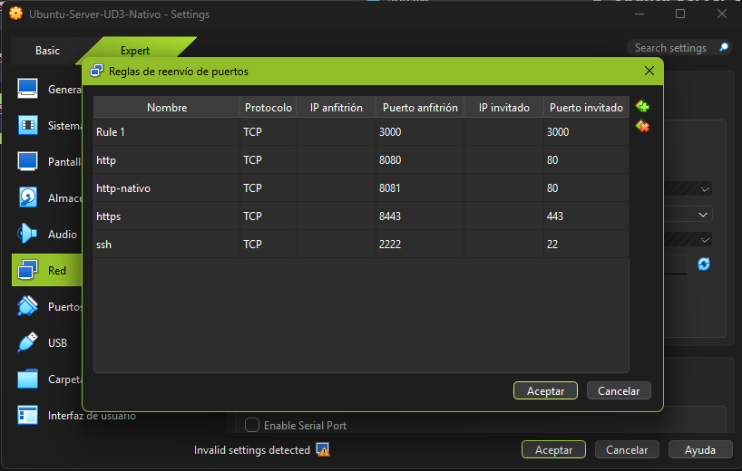
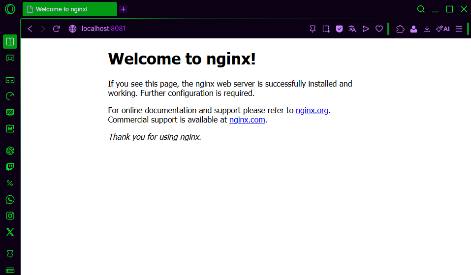
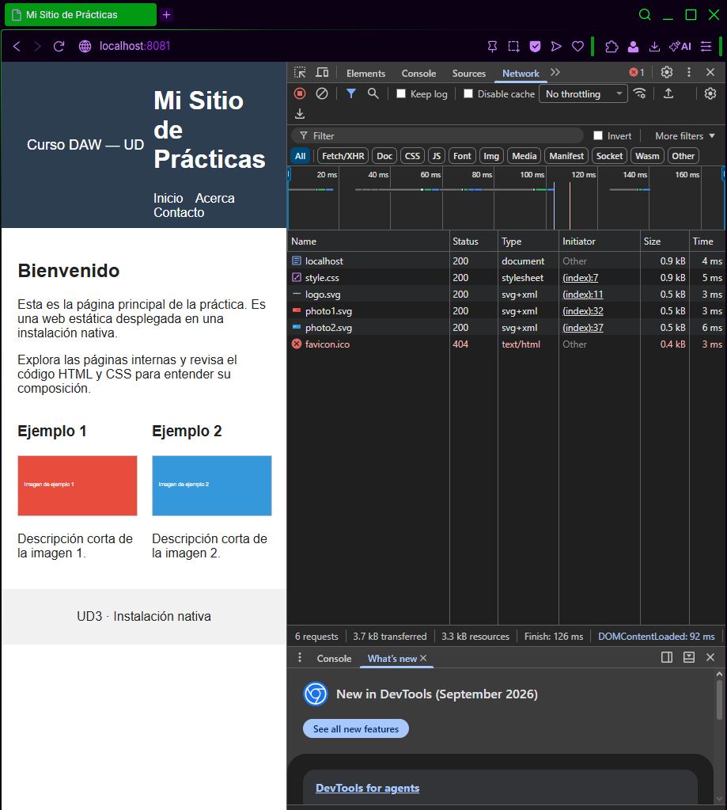

# Práctica 1: Instalación nativa de Nginx

## Parte 1: preparar la máquina virtual

### Reglas de redirección de puertos



### Salida de `hostname` y `whoami`

```bash
hostname
# ubuntu-server

whoami
# dawserver
```

---

## Parte 2: instalar Nginx

### Comprobación de la instalación de Nginx

* **`nginx -v`**

```text
nginx version: nginx/1.18.0 (Ubuntu)
```

* **`systemctl status nginx --no-pager`**

```text
● nginx.service - A high performance web server and a reverse proxy server
     Loaded: loaded (/lib/systemd/system/nginx.service; enabled; vendor preset: enabled)
     Active: active (running) since Thu 2026-11-19 16:17:36 UTC; 58s ago
       Docs: man:nginx(8)
    Process: 1935 ExecStartPre=/usr/sbin/nginx -t -q -g daemon on; master_process on; (code=exited, status=0/SUCCESS)
    Process: 1936 ExecStart=/usr/sbin/nginx -g daemon on; master_process on; (code=exited, status=0/SUCCESS)
   Main PID: 2027 (nginx)
      Tasks: 3 (limit: 2216)
     Memory: 7.4M
        CPU: 47ms
     CGroup: /system.slice/nginx.service
             ├─2027 "nginx: master process /usr/sbin/nginx -g daemon on; master_process on;"
             ├─2029 "nginx: worker process" "" "" "" "" "" "" "" "" "" "" "" "" "" "" "" "" "" "" "" "" "" "" "" "" "" "" ""
             └─2030 "nginx: worker process" "" "" "" "" "" "" "" "" "" "" "" "" "" "" "" "" "" "" "" "" "" "" "" "" "" "" ""
Nov 19 16:17:36 ubuntu-server systemd[1]: Starting A high performance web server and a reverse proxy server...
Nov 19 16:17:36 ubuntu-server systemd[1]: Started A high performance web server and a reverse proxy server.
```

* **`systemctl is-enabled nginx`**

```text
enabled
```

* **`sudo ss -tlnp | grep ':80'`**

```text
LISTEN 0      511          0.0.0.0:80        0.0.0.0:*    users:(("nginx",pid=2030,fd=6),("nginx",pid=2029,fd=6),("nginx",pid=2027,fd=6))
LISTEN 0      511             [::]:80           [::]:*    users:(("nginx",pid=2030,fd=7),("nginx",pid=2029,fd=7),("nginx",pid=2027,fd=7))
```

* **`ps -C nginx -o user,pid,cmd`**

```text
USER         PID CMD
root        2027 nginx: master process /usr/sbin/nginx -g daemon on; master_process on;
www-data    2029 nginx: worker process
www-data    2030 nginx: worker process
```

* **`curl -I http://localhost/`**

```text
HTTP/1.1 200 OK
Server: nginx/1.18.0 (Ubuntu)
Date: Thu, 19 Nov 2026 16:19:36 GMT
Content-Type: text/html
Content-Length: 612
Last-Modified: Thu, 19 Nov 2026 16:17:34 GMT
Connection: keep-alive
ETag: "6aff211e-264"
Accept-Ranges: bytes
```

### Página de bienvenida en el navegador



---

## Parte 3: dónde está cada cosa

### Exploración de lo que creó Nginx al instalarse

* **`ls /etc/nginx/`**

```text
conf.d        fastcgi_params  koi-win     modules-available  nginx.conf    scgi_params      sites-enabled  uwsgi_params
fastcgi.conf  koi-utf         mime.types  modules-enabled    proxy_params  sites-available  snippets       win-utf
```

* **`ls -l /etc/nginx/sites-available/ /etc/nginx/sites-enabled/`**

```text
/etc/nginx/sites-available/:
total 4
-rw-r--r-- 1 root root 2412 May 30  2023 default
/etc/nginx/sites-enabled/:
total 0
lrwxrwxrwx 1 root root 34 Nov 19 16:17 default -> /etc/nginx/sites-available/default
```

* **`grep -n "include\|^user" /etc/nginx/nginx.conf`**

```text
1:user www-data;
4:include /etc/nginx/modules-enabled/*.conf;
25:     include /etc/nginx/mime.types;
59:     include /etc/nginx/conf.d/*.conf;
60:     include /etc/nginx/sites-enabled/*;
```

* **`ls -l /var/www/html/`**

```text
total 4
-rw-r--r-- 1 root root 612 Nov 19 16:17 index.nginx-debian.html
```

* **`ls -l /var/log/nginx/`**

```text
total 8
-rw-r----- 1 www-data adm 515 Nov 19 16:25 access.log
-rw-r----- 1 www-data adm  76 Nov 19 16:17 error.log
```

### Preguntas

* **¿Qué líneas de `nginx.conf` hacen que Nginx lea los sitios?**
  Las líneas `59: include /etc/nginx/conf.d/*.conf;` y `60: include /etc/nginx/sites-enabled/*;`.

* **¿Qué usuario indica la directiva `user`, y cuál indicaba en la imagen de Docker?**
  En la instalación nativa de Ubuntu indica `user www-data;`, mientras que en la imagen oficial de Docker indica `user nginx;`.

---

## Parte 4: el cortafuegos

### Pruebas del cortafuegos UFW

* **Salida de `sudo ufw status verbose`**

```text
Status: active
Logging: on (low)
Default: deny (incoming), allow (outgoing), disabled (routed)
New profiles: skip
To                         Action      From
--                         ------      ----
22/tcp (OpenSSH)           ALLOW IN    Anywhere
80/tcp (Nginx HTTP)        ALLOW IN    Anywhere
22/tcp (OpenSSH (v6))      ALLOW IN    Anywhere (v6)
80/tcp (Nginx HTTP (v6))   ALLOW IN    Anywhere (v6)
```

### Explicación de cada prueba

* **Prueba con `curl` en la máquina virtual (puerto 80 cerrado):** Funciona porque el tráfico local no pasa por el filtro del cortafuegos.
* **Prueba desde el navegador del anfitrión (puerto 80 cerrado):** No carga porque UFW bloquea por defecto todo el tráfico entrante que no esté permitido explícitamente.
* **Prueba tras `sudo ufw allow 'Nginx HTTP'`:** La página vuelve a cargar desde el anfitrión porque el cortafuegos ya permite las conexiones entrantes al puerto 80.

---

## Parte 5: subir el sitio al servidor

### Comprobación de que el sitio está en su carpeta y con los permisos indicados

* **`ls -lR /var/www/sitio`**

```text
/var/www/sitio/:
total 20
-rw-r--r-- 1 root root  872 Nov 19 17:01 about.html
-rw-r--r-- 1 root root  943 Nov 19 17:01 contact.html
drwxr-xr-x 2 root root 4096 Nov 19 17:01 css
drwxr-xr-x 2 root root 4096 Nov 19 17:01 img
-rw-r--r-- 1 root root 1260 Nov 19 17:01 index.html

/var/www/sitio/css:
total 4
-rw-r--r-- 1 root root 656 Nov 19 17:01 style.css

/var/www/sitio/img:
total 12
-rw-r--r-- 1 root root 269 Nov 19 17:01 logo.svg
-rw-r--r-- 1 root root 265 Nov 19 17:01 photo1.svg
-rw-r--r-- 1 root root 265 Nov 19 17:01 photo2.svg
```

---

## Parte 6: crear y activar el sitio

### Contenido del archivo de configuración (`/etc/nginx/sites-available/sitio`)

```nginx
server {
    listen 80;
    server_name _;
    root /var/www/sitio;
    index index.html;
    access_log /var/log/nginx/sitio.access.log;

    location / {
        try_files $uri $uri/ =404;
    }
}
```

### Listado de `sites-enabled`

```text
total 0
lrwxrwxrwx 1 root root 32 Nov 19 17:11 sitio -> /etc/nginx/sites-available/sitio
```

### Captura de la pestaña Red con los recursos cargados



### Preguntas

* **¿Se ha borrado la configuración del sitio por defecto?**
  No, solo se ha borrado el enlace simbólico en `/etc/nginx/sites-enabled/default`; el archivo original sigue intacto en `/etc/nginx/sites-available/default`.

* **¿Cómo lo volverías a activar?**
  Creando de nuevo el enlace simbólico con `sudo ln -s /etc/nginx/sites-available/default /etc/nginx/sites-enabled/` y recargando Nginx con `sudo systemctl reload nginx`.

---

## Parte 7: provocar errores y diagnosticarlos

### Recargar frente a reiniciar

* **`sudo nginx -t`**

```text
nginx: [emerg] invalid number of arguments in "root" directive in /etc/nginx/sites-enabled/sitio:5
nginx: configuration file /etc/nginx/nginx.conf test failed
```

* **`sudo systemctl reload nginx`**

```text
Job for nginx.service failed.
See "systemctl status nginx.service" and "journalctl -xeu nginx.service" for details.
```

* **`curl -I http://localhost/`**

```text
HTTP/1.1 200 OK
Server: nginx/1.18.0 (Ubuntu)
Date: Thu, 19 Nov 2026 17:54:17 GMT
Content-Type: text/html
Content-Length: 1260
Last-Modified: Thu, 19 Nov 2026 17:01:20 GMT
Connection: keep-alive
ETag: "6aff2b60-4ec"
Accept-Ranges: bytes
```

* **`sudo systemctl restart nginx`**

```text
Job for nginx.service failed because the control process exited with error code.
See "systemctl status nginx.service" and "journalctl -xeu nginx.service" for details.
```

* **`systemctl status nginx --no-pager`**

```text
× nginx.service - A high performance web server and a reverse proxy server
     Loaded: loaded (/lib/systemd/system/nginx.service; enabled; vendor preset: enabled)
     Active: failed (Result: exit-code) since Thu 2026-11-19 18:02:07 UTC; 13s ago
       Docs: man:nginx(8)
    Process: 59462 ExecStartPre=/usr/sbin/nginx -t -q -g daemon on; master_process on; (code=exited, status=1/FAILURE)
        CPU: 12ms
Nov 19 18:02:07 ubuntu-server systemd[1]: Starting A high performance web server and a reverse proxy server...
Nov 19 18:02:07 ubuntu-server nginx[59462]: nginx: [emerg] invalid number of arguments in "root" directive in /etc/nginx/sit…d/sitio:5
Nov 19 18:02:07 ubuntu-server nginx[59462]: nginx: configuration file /etc/nginx/nginx.conf test failed
Nov 19 18:02:07 ubuntu-server systemd[1]: nginx.service: Control process exited, code=exited, status=1/FAILURE
Nov 19 18:02:07 ubuntu-server systemd[1]: nginx.service: Failed with result 'exit-code'.
Nov 19 18:02:07 ubuntu-server systemd[1]: Failed to start A high performance web server and a reverse proxy server.
Hint: Some lines were ellipsized, use -l to show in full.
```

* **`curl -I http://localhost/`**

```text
curl: (7) Failed to connect to localhost port 80 after 1 ms: Connection refused
```

* **`sudo journalctl -u nginx -n 10 --no-pager`**

```text
Nov 19 17:53:59 ubuntu-server systemd[1]: Reload failed for A high performance web server and a reverse proxy server.
Nov 19 18:02:07 ubuntu-server systemd[1]: Stopping A high performance web server and a reverse proxy server...
Nov 19 18:02:07 ubuntu-server systemd[1]: nginx.service: Deactivated successfully.
Nov 19 18:02:07 ubuntu-server systemd[1]: Stopped A high performance web server and a reverse proxy server.
Nov 19 18:02:07 ubuntu-server systemd[1]: Starting A high performance web server and a reverse proxy server...
Nov 19 18:02:07 ubuntu-server nginx[59462]: nginx: [emerg] invalid number of arguments in "root" directive in /etc/nginx/sites-enabled/sitio:5
Nov 19 18:02:07 ubuntu-server nginx[59462]: nginx: configuration file /etc/nginx/nginx.conf test failed
Nov 19 18:02:07 ubuntu-server systemd[1]: nginx.service: Control process exited, code=exited, status=1/FAILURE
Nov 19 18:02:07 ubuntu-server systemd[1]: nginx.service: Failed with result 'exit-code'.
Nov 19 18:02:07 ubuntu-server systemd[1]: Failed to start A high performance web server and a reverse proxy server.
```

**Causa:** Al faltar el `;` en `root`, hay un error de sintaxis en la configuración. Con `reload`, Nginx rechaza el cambio pero sigue sirviendo con la configuración válida anterior; con `restart`, detiene el servicio y no consigue volver a arrancarlo, tirando la web.

### Permisos

* **`curl -I http://localhost/css/style.css`**

```text
HTTP/1.1 403 Forbidden
Server: nginx/1.18.0 (Ubuntu)
Date: Thu, 19 Nov 2026 18:09:32 GMT
Content-Type: text/html
Content-Length: 162
Connection: keep-alive
```

* **`sudo tail -n 3 /var/log/nginx/error.log`**

```text
2026/11/19 17:53:59 [emerg] 59450#59450: invalid number of arguments in "root" directive in /etc/nginx/sites-enabled/sitio:5
2026/11/19 18:02:07 [emerg] 59462#59462: invalid number of arguments in "root" directive in /etc/nginx/sites-enabled/sitio:5
2026/11/19 18:09:32 [error] 59492#59492: *1 open() "/var/www/sitio/css/style.css" failed (13: Permission denied), client: 127.0.0.1, server: _, request: "HEAD /css/style.css HTTP/1.1", host: "localhost"
```

**Causa:** Al poner permisos `600` sobre `style.css`, el usuario `www-data` con el que corren los trabajadores de Nginx deja de tener permiso de lectura sobre ese archivo y devuelve `403 Forbidden`.

### Logs

* **`sudo tail -f /var/log/nginx/sitio.access.log`**

```text
10.0.2.2 - - [19/Nov/2026:18:18:25 +0000] "GET /contact.html HTTP/1.1" 304 0 "http://localhost:8081/about.html" "Mozilla/5.0 (Windows NT 10.0; Win64; x64) AppleWebKit/537.36 (KHTML, like Gecko) Chrome/155.0.0.0 Safari/537.36 OPR/139.0.0.0"
10.0.2.2 - - [19/Nov/2026:18:18:26 +0000] "GET /index.html HTTP/1.1" 304 0 "http://localhost:8081/contact.html" "Mozilla/5.0 (Windows NT 10.0; Win64; x64) AppleWebKit/537.36 (KHTML, like Gecko) Chrome/155.0.0.0 Safari/537.36 OPR/139.0.0.0"
10.0.2.2 - - [19/Nov/2026:18:18:26 +0000] "GET /img/photo1.svg HTTP/1.1" 304 0 "http://localhost:8081/index.html" "Mozilla/5.0 (Windows NT 10.0; Win64; x64) AppleWebKit/537.36 (KHTML, like Gecko) Chrome/155.0.0.0 Safari/537.36 OPR/139.0.0.0"
10.0.2.2 - - [19/Nov/2026:18:18:26 +0000] "GET /img/photo2.svg HTTP/1.1" 304 0 "http://localhost:8081/index.html" "Mozilla/5.0 (Windows NT 10.0; Win64; x64) AppleWebKit/537.36 (KHTML, like Gecko) Chrome/155.0.0.0 Safari/537.36 OPR/139.0.0.0"
10.0.2.2 - - [19/Nov/2026:18:18:32 +0000] "GET /contact.html?nombre=&email=&mensaje= HTTP/1.1" 200 522 "http://localhost:8081/contact.html" "Mozilla/5.0 (Windows NT 10.0; Win64; x64) AppleWebKit/537.36 (KHTML, like Gecko) Chrome/155.0.0.0 Safari/537.36 OPR/139.0.0.0"
```

* **`cat /etc/logrotate.d/nginx`**

```text
/var/log/nginx/*.log {
        daily
        missingok
        rotate 14
        compress
        delaycompress
        notifempty
        create 0640 www-data adm
        sharedscripts
        prerotate
                if [ -d /etc/logrotate.d/httpd-prerotate ]; then \
                        run-parts /etc/logrotate.d/httpd-prerotate; \
                fi \
        endscript
        postrotate
                invoke-rc.d nginx rotate >/dev/null 2>&1
        endscript
}
```

---

## Parte 8: reinicio de la máquina

### Comprobación de si el sitio sigue funcionando después de reiniciar la maquina

* **`systemctl is-active nginx`**

```text
active
```

* **`curl -I http://localhost/`**

```text
HTTP/1.1 200 OK
Server: nginx/1.18.0 (Ubuntu)
Date: Fri, 20 Nov 2026 10:56:39 GMT
Content-Type: text/html
Content-Length: 1260
Last-Modified: Thu, 19 Nov 2026 17:01:20 GMT
Connection: keep-alive
ETag: "6aff2b60-4ec"
Accept-Ranges: bytes
```

* **¿Qué es lo que hace que Nginx vuelva a arrancar?**
  Lo que hace que Nginx vuelva a arrancar es el hecho de que está habilitado (`enabled`) en `systemd`, por lo que arranca automáticamente al encender la máquina.

---

## Parte 9: comparar con los contenedores

| Aspecto | Instalación nativa | Contenedor |
| :--- | :--- | :--- |
| **Orden de instalación** | `sudo apt install -y nginx` | `docker run ... nginx` |
| **Versión de Nginx instalada y quién decide cuál es** | La que ofrecen los repositorios de la distribución | La que tú eliges con la etiqueta `tag`, por ejemplo: `nginx:1.27-alpine` |
| **Arrancar, detener y recargar** | `sudo systemctl start / stop / reload nginx` | `docker compose up / down` |
| **Arranque automático con el sistema** | `sudo systemctl enable nginx` | Escribir en el compose: `restart: always` |
| **Archivo de configuración del sitio** | `/etc/nginx/sites-available/` enlazado en `/etc/nginx/sites-enabled/` | Montado como bind mount directamente en `/etc/nginx/conf.d/` |
| **Raíz de documentos** | `/var/www/html/` por defecto o `/var/www/sitio/` en este caso | `/usr/share/nginx/html/` |
| **Usuario de los procesos trabajadores** | `www-data` | `nginx` |
| **Ubicación de los logs** | `/var/log/nginx/` | Son una salida estándar (`stdout` y `stderr`) la cual se consulta con `docker logs` |
| **Cómo se abre el puerto** | `sudo ufw allow 'Nginx HTTP'` | Al crear el contenedor con, por ejemplo: `-p 8080:80`, ya que Docker se salta UFW |
| **Cómo se actualiza a una versión nueva** | `sudo apt update && sudo apt upgrade` | Cambiando el tag de la imagen, descargando la nueva y recreando de nuevo el contenedor |
| **Cómo se deja todo como estaba** | Desinstalando el paquete con `sudo apt purge nginx`, borrando archivos, enlaces, carpetas ubicadas en `/var/www/` y borrando las reglas de UFW | `docker rm -f <contenedor>` o `docker compose down -v` |

### Preguntas

1. **¿Qué pasos has tenido que hacer aquí que el contenedor te daba resueltos?**
   Son unos cuantos, así que voy a hacer una lista:
   * Instalar el paquete junto con sus dependencias.
   * Gestionar el servicio manualmente con `systemctl` para arrancarlo, recargarlo y comprobar que arranca con el sistema.
   * Configurar el cortafuegos para abrir el puerto 80.
   * Subir los archivos al servidor y ajustar a mano los propietarios y los permisos para que `www-data` pueda leerlos.
   * Crear la estructura de `sites-available` y `sites-enabled`, desactivar el sitio `default` y consultar los logs directamente en los archivos del disco en lugar de usar un solo comando.

2. **Un compañero necesita tener exactamente el mismo servidor. ¿Qué tendría que hacer en cada caso?**
   Los pasos para cada uno de los dos casos son estos:
   * **Instalación nativa:** tendría que repetir paso a paso toda esta guía en su máquina, lo cual supone instalar tanto Ubuntu como Nginx, abrir los puertos en UFW, copiar los archivos del sitio, ajustar sus permisos, crear el archivo de configuración en `sites-available`, crear el enlace en `sites-enabled`, quitar el `default` y recargar el servicio. Esto conlleva unos riesgos, los cuales son que podría equivocarse en cualquier paso o acabar con una versión distinta según su sistema operativo.
   * **Contenedor:** para esto solo tendría que clonar el repositorio con el `compose.yaml` y el `Dockerfile` (si lo hubiese) y ejecutar `docker compose up -d`. Con esto tendría exactamente lo mismo que yo en menos de un minuto.

3. **¿En qué situación elegirías una instalación nativa y en cuál, contenedores?**
   * **Instalación nativa:** Cuando tengo un servidor fijo que solo va a ejecutar un servicio concreto y no necesito cambiarlo de máquina ni tocarlo mucho. Así aprovecho las herramientas que ya trae el sistema.
   * **Contenedores:** Cuando trabajo en equipo, por ejemplo, y tengo varios servicios a la vez como una web con base de datos o necesito una versión concreta de un programa sin depender de la que traiga Ubuntu. Además, hace que sea mucho más rápido montar el mismo proyecto en otro ordenador o servidor sin que fallen las configuraciones.